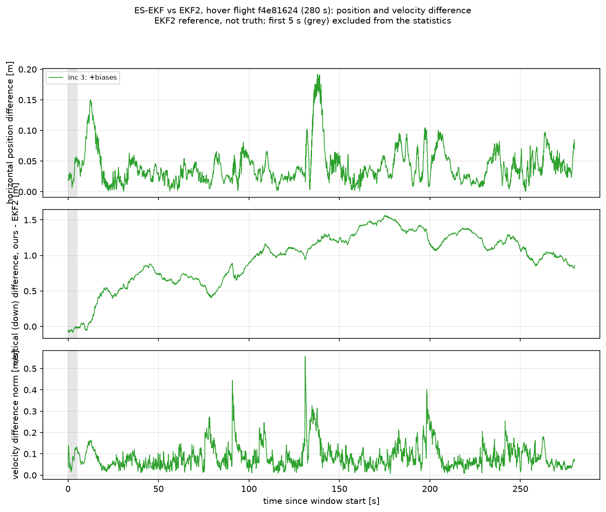
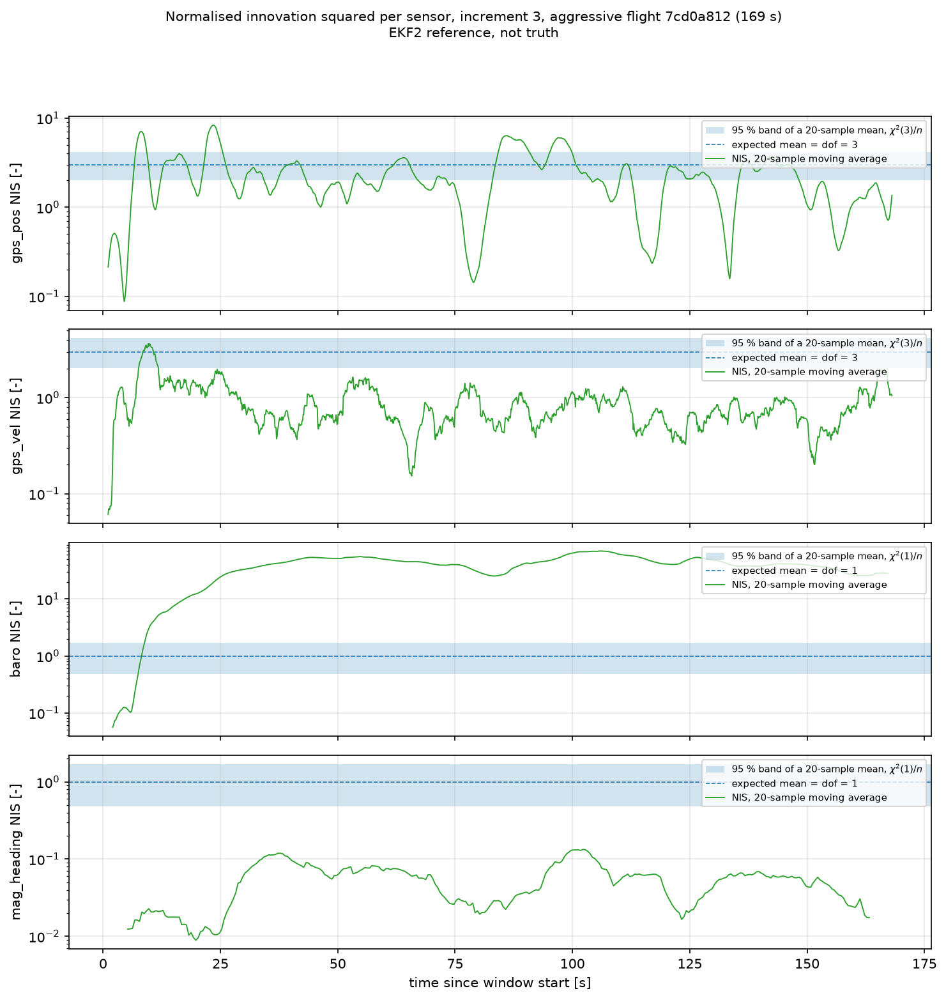
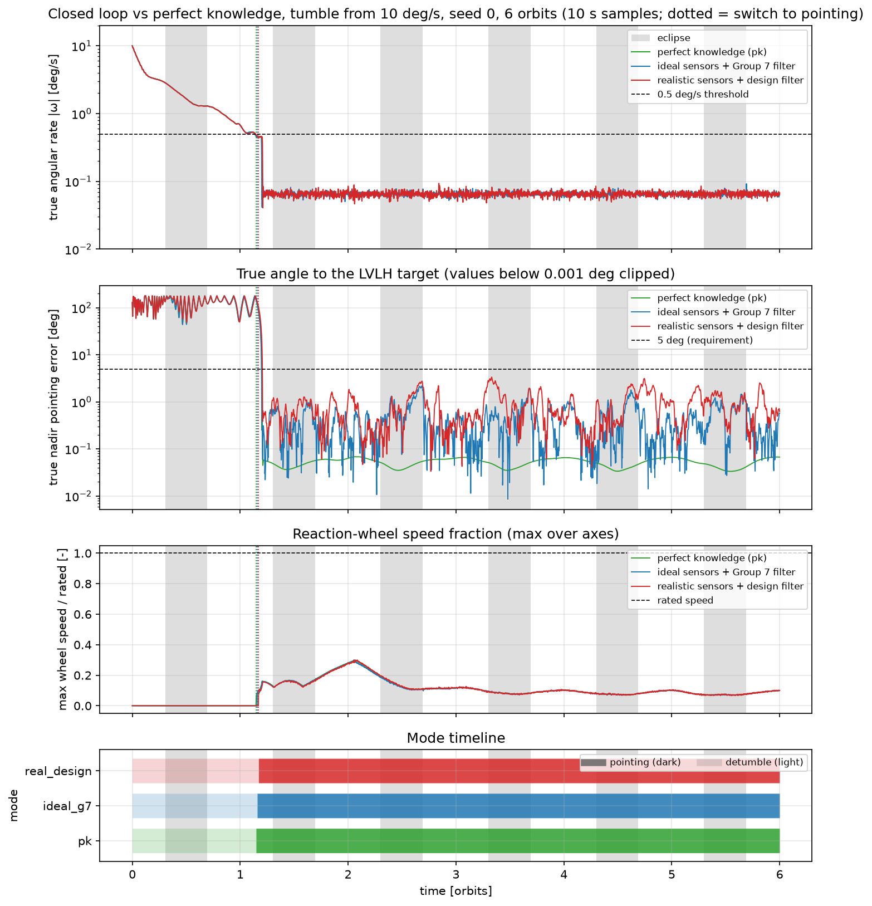
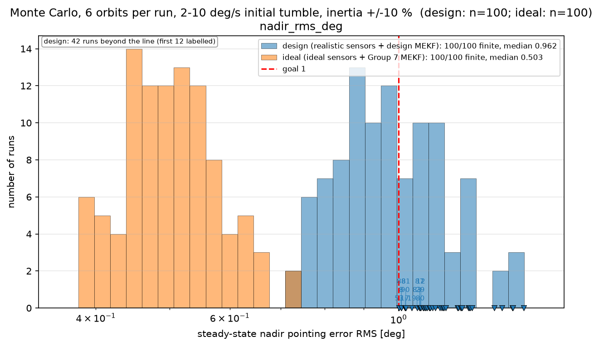
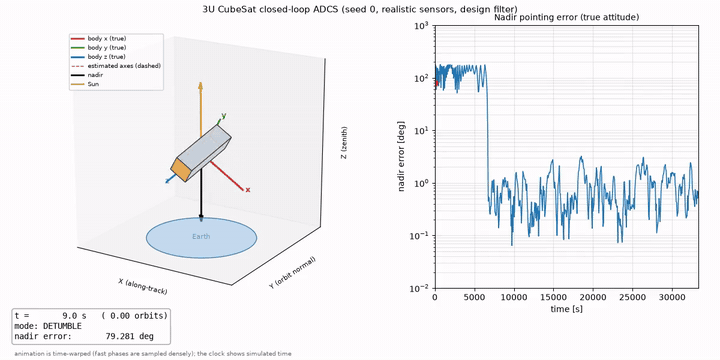
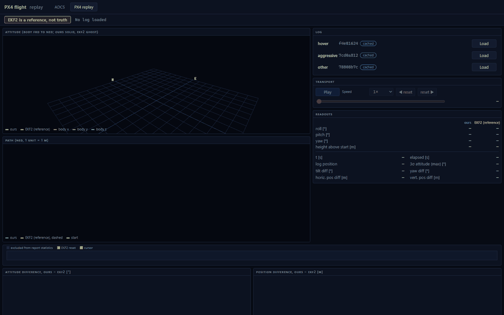

# Space Estimation & Control — PX4 Sensor Fusion + 3U CubeSat ADCS

Two linked pure-Python projects built on a shared error-state EKF and quaternion spine (`common/`).

- **Project A — PX4 sensor fusion.** A 15-state error-state EKF (position, velocity, attitude, gyro bias, accelerometer bias) fuses IMU, GPS, barometer and magnetometer data from three pinned real PX4 `.ulg` flight logs and is compared with the onboard EKF2 estimate. **EKF2 is a reference, not truth**: every Project A figure is a difference to EKF2, not an error.
- **Project B — 3U CubeSat ADCS.** A closed-loop attitude determination and control system (ADCS) simulation for a 3U CubeSat (4 kg) in a 400 km, 51.6° orbit: B-dot detumble, reaction-wheel nadir pointing with magnetorquer momentum dumping, TRIAD initialisation and a multiplicative EKF (MEKF) on a magnetometer, six coarse sun sensors and a gyro, evaluated with a 100-run Monte Carlo campaign. **All Project B results are simulation results.**

Both projects use scalar-first Hamilton quaternions and a 3-element attitude error in the filter covariance, implemented once in `common/`. Per-group status, measured numbers and open issues: [`PROGRESS.md`](PROGRESS.md).

## Headline results

### Project A — filter vs EKF2 (RMS difference after the first 5 s, increment 3)

| Log (role, id prefix) | Window [s] | posH [m] | posD [m] | vel [m/s] | tilt [°] | yaw [°] | NIS ratio gps_pos / gps_vel / baro / mag |
|---|---|---|---|---|---|---|---|
| hover, `f4e81624` | 280.02 | 0.050 | 1.040 | 0.105 | 1.05 | 5.78 | 0.27 / 0.075 / 1.18 / 0.089 |
| aggressive, `7cd0a812` | 169.34 | 0.055 | 0.753 | 0.090 | 0.37 | 1.38 | 0.79 / 0.30 / 39.4 / 0.053 |
| other (RTK GPS, PX4 v1.14), `78808b7c` | 674.49 | 0.255 | 0.929 | 0.216 | 0.56 | 1.80 | 0.42 / 0.27 / 1.10 / 0.31 |

Sources: `sensor_fusion/report/final_metrics_<id>.json` (`comparison_vs_ekf2`, `consistency`), `PROGRESS.md` (Group 4 "Final numbers"), `sensor_fusion/report/writeup.md`. NIS ratio = mean NIS / dof (1 is expected for a consistent filter). Attitude statistics exclude ±1 s around the single EKF2 yaw reset per log.

- Both filters fuse the same GPS data, so the small horizontal difference is not an accuracy claim. The posD column is **not an accuracy measure** (EKF2 follows GPS height on two logs and baro on one).
- Only baro on hover and other is near NIS ratio 1; the other ratios are 0.05–0.79, i.e. the noise models are conservative. The aggressive-log baro ratio of 39.4 is consistent with GPS height drift against baro (`sensor_fusion/report/height_diagnostics.json`); a baro-offset state was not tried.
- Tuning changed one parameter (`gps_pos_floor_v` 0.5 → 0.125 m); total consistency score 1.816 → 1.770 (`writeup.md`, `PROGRESS.md`). The sweep's lower-scoring winner was rejected on review because it made the gyro bias overconfident.
- Dead reckoning from the raw IMU (no bias removal) drifts to 695 m (hover), 320 m (aggressive) and 256 m (other) after 60 s (`sensor_fusion/report/dr_metrics_<id>.json`, `PROGRESS.md` Group 2), which is why the filter needs GPS.

### Project B — cost of estimation (6 orbits, 10 °/s initial tumble, seeds 0–4, means)

| Case | Nadir RMS [°] | Nadir max [°] | Knowledge RMS [°] | NEES (dof 3) |
|---|---|---|---|---|
| Perfect knowledge | 0.0537 | 0.0679 | – | – |
| Ideal sensors + Group 7 filter | 0.532 | 1.915 | 0.513 | 3.05 |
| Realistic sensors + Group 7 filter | 24.4 | 57.2 | 24.1 | 6377 |
| Realistic sensors + design filter | 0.987 | 3.015 | 0.960 | 13.7 |

Source: `adcs/report/closed_loop_metrics.json` (`cases.<key>.aggregate`), tabulated in `adcs/report/design_document.md` section 4.4. "Realistic" = truth-side errors the filter does not model: magnetometer bias, onboard field model truncated to degree 8 plus an unmodelled field, ±60° sun-sensor field of view, Earth albedo (assumed magnitudes, `assumptions.md` B-21). The design filter adds magnetometer-bias states and per-diode sun-sensor updates (B-22).

The Group 7 filter degrades to 24.4° RMS with realistic errors and **reports nothing wrong**: the rate-based fallback cannot see a wrong attitude estimate, and the internal `success` flag stays true.

### Project B — Monte Carlo (100 runs per campaign, 6 orbits, base seed 2026, 2–10 °/s initial rate, ±10 % truth inertia)

| Metric (median / p95 / max) | Design campaign (realistic sensors + design filter) | Ideal campaign (ideal sensors + Group 7 filter) |
|---|---|---|
| Detumble time [orbits] | 1.22 / 1.88 / 2.29 | 1.21 / 1.63 / 1.89 |
| Switch to pointing [orbits] | 1.21 / 1.88 / 2.23 | 1.17 / 1.66 / 1.85 |
| Nadir RMS [°] | 0.962 / 1.25 / 1.46 | 0.503 / 0.635 / 0.733 |
| Nadir max [°] | 3.15 / 4.44 / 5.19 | 1.84 / 2.90 / 3.59 |
| Attitude NEES (mean) | 13.7 / 16.4 / 19.9 | 3.00 / 3.25 / 3.59 |
| All requirements met | **99/100** (run 54 fails the 5° maximum at 5.19°) | 100/100 |
| 1° RMS goal (a goal, not a requirement) | **58/100** | 100/100 |

Source: `adcs/report/monte_carlo_summary.md` (from `monte_carlo_design.json`, `monte_carlo_ideal.json`). The requirement thresholds (3 orbits detumble, 4 orbits acquisition, 5° maximum, 2° knowledge RMS) are assumed values fixed before the campaign (`assumptions.md` B-24), not derived mission needs.

## Repository layout

```
README.md  CONVENTIONS.md  assumptions.md  PROGRESS.md  CLAUDE.md  requirements.txt  pyproject.toml
.claude/agents/            project subagent definitions
docs/IMPLEMENTATION_PLAN.md  docs/specs/ (module specs)  docs/review_scratch/group7/ (unreviewed review scripts)
common/        quaternion.py  ekf.py  frames.py  plotting.py  tests/
sensor_fusion/ download_logs.py  loader.py  interp.py  inspect_logs.py  dead_reckoning.py  synthetic.py
               ekf_drone.py  metrics.py  run_flight.py  tests/
               report/  dr_study.py  ekf_study.py  ekf_figures.py  tuning_sweep.py  height_diagnostics.py
                        writeup.md  *_metrics*.json  tuning_sweep.{json,md}  figures/
               data/    NOTES.md  (the .ulg logs are gitignored)
adcs/          config.py  orbit.py  environment.py  dynamics.py  disturbances.py  actuators.py
               sensors.py  estimation.py  control.py  simulate.py  monte_carlo.py
               visualize.py   3D visualizer (Group 9)   stepper.py   step-by-step closed loop (Group 10)
               tests/
               report/  physics_figures.py  control_figures.py  estimation_figures.py  closed_loop_figures.py
                        monte_carlo_figures.py  mc_worst_runs.py  design_document.md  monte_carlo_summary.md
                        *_metrics.json  monte_carlo_{design,ideal}.json  mc_worst_runs.json  figures/
webapp/        __main__.py   python -m webapp (browser simulator, Groups 10-12)
               server/    app.py  schemas.py  adcs_session.py  px4_replay.py  tests/
               frontend/  Vite + TypeScript + Three.js + uPlot: src/adcs/  src/px4/  src/math/  tests/
               docs/      browser-check GIFs
```

## Conventions

Full definitions in [`CONVENTIONS.md`](CONVENTIONS.md): SI units internally (radians, degrees only in plots and reports); quaternions scalar-first `[w, x, y, z]`, Hamilton product, body-to-reference (same as PX4 `vehicle_attitude.q` and SciPy `Rotation` with reordering); the filters carry a 3-element body-frame rotation-vector attitude error, Joseph-form covariance updates and NIS checks; frames ECI/ECEF/LLA/LVLH (Project B) and NED + FRD body (Project A). It is **attitude** determination and control; "altitude" means genuine height only. Every physical assumption is in [`assumptions.md`](assumptions.md) and cited by ID in the reports.

## Setup (Windows)

```powershell
py -3.14 -m venv .venv
.venv\Scripts\activate
pip install -r requirements.txt
pip install -e .
python -m pytest -q
```

If a dependency lacks a Python 3.14 wheel, use `py -3.12` for the virtual environment. The full test suite has 1800 tests (1799 pass; 1 opt-in real-log replay test skips unless `PX4_REPLAY_REAL=1`; `PROGRESS.md`) and takes about 5 min. The `webapp` tests skip without the `[web]` extra. The Project A real-log tests skip if the `.ulg` files have not been downloaded.

## Reproducing the results

Commands assume the activated venv and the repository root as working directory. Wall times were measured on a machine where 20 worker processes were used (`PROGRESS.md`); on other hardware they will differ.

**Worker counts.** Not every multiprocessing script defaults to 20 workers. `sensor_fusion.report.tuning_sweep` and `adcs.report.closed_loop_figures` default to `--workers 20`; `adcs.monte_carlo` defaults to `cpu_count - 2`; `adcs.report.mc_worst_runs` defaults to `--workers 5`; `adcs.report.control_figures` and `adcs.report.estimation_figures` have no flag and use `cpu_count - 2` processes. Pass `--workers N` where it exists.

### Project A — PX4 sensor fusion

```powershell
python -m sensor_fusion.download_logs        # 3 pinned Flight Review logs, about 46 MB, to sensor_fusion/data/
python -m sensor_fusion.run_flight all       # final filter on all three logs: final_metrics_<id>.json + figures/final_<id>_*.png
```

`run_flight` takes a role (`hover`, `aggressive`, `other`), a log id or `all`, plus `--increment {1,2,3}` (default 3), `--set key=value` overrides, `--no-figures`, `--prefix`. A single filter run took 9–32 s (Group 3 runs, `PROGRESS.md`). Study scripts behind the writeup:

```powershell
python -m sensor_fusion.inspect_logs                   # data inspection figures
python -m sensor_fusion.report.dr_study                # dead-reckoning drift  -> dr_metrics_<id>.json
python -m sensor_fusion.report.ekf_study               # increments 1-3 with Group 3 defaults, about 3 min
python -m sensor_fusion.report.tuning_sweep            # 120 runs, 500 s on 20 workers (--workers, --budget-min)
python -m sensor_fusion.report.height_diagnostics      # GPS/baro/EKF2 height diagnostics
```

Wall times measured in the fresh-venv check below (a loaded machine, so the CPU-bound ones are slower than the numbers above): download 132 s, `inspect_logs` 20 s, `dr_study` 23 s, `run_flight all` 240 s, `ekf_study` 610 s, `height_diagnostics` 439 s, `tuning_sweep` 1289 s.

### Project B — CubeSat ADCS

```powershell
python -m adcs.simulate                                  # closed loop, realistic sensors + design filter, 10 deg/s tumble to nadir
python -m adcs.report.physics_figures                    # about 33 s
python -m adcs.report.control_figures                    # 93 runs, 562 s on 20 processes
python -m adcs.report.estimation_figures                 # 57 runs, about 110 s on 20 processes
python -m adcs.report.closed_loop_figures                # 58 runs, 719 s (--workers, default 20)
python -m adcs.monte_carlo                               # both campaigns; 1346 s (design) + 1156 s (ideal) on 20 workers
python -m adcs.report.monte_carlo_figures                # mc_*.png and monte_carlo_summary.md
python -m adcs.report.mc_worst_runs                      # mc_worst_runs.json and figures/mc_worst_run.png
```

`python -m adcs.simulate` options: `--knowledge {estimated,perfect}`, `--sensors {realistic,ideal}`, `--filter {design,g7}`, `--scenario {detumble,pointing,auto}` (default `auto`), `--orbits`, `--rate-deg` (default 10), `--seed`, `--no-dumping`. `python -m adcs.monte_carlo` options: `--campaign {design,ideal,all}` (default `all`), `--n` (100), `--orbits` (6), `--workers`, `--base-seed` (2026), `--out`, `--no-figures`; it calls the figure script itself unless `--no-figures`. Wall times: `physics_figures` 72 s (loaded machine); one 6-orbit closed-loop run (`adcs.simulate`, same as the visualizer's simulation step) took 193 s on an idle machine and 763 s on the loaded one. `monte_carlo_figures` took 3 s and `mc_worst_runs` 67 s (5 workers, its default); on 6 workers the two Monte Carlo campaigns took 1109 s (design) and 892 s (ideal).

## Gallery

| | |
|---|---|
|  |  |
| Project A, hover: horizontal, vertical and velocity difference to EKF2 (EKF2 reference, not truth). `sensor_fusion/report/figures/final_f4e81624-7ccc-4859-bb45-d02fa0246b77_pos.png` | Project A, aggressive: NIS per sensor with 95 % bands; baro is far above 1, mag far below. `sensor_fusion/report/figures/final_7cd0a812-d6d6-4c67-9da8-1f3a9cc460b0_nis.png` |
|  |  |
| Project B: rate, true nadir error and wheel speed for perfect knowledge, ideal and realistic sensors (seed 0). `adcs/report/figures/closed_loop_vs_pk.png` | Project B: Monte Carlo nadir RMS histograms, design vs ideal campaign. `adcs/report/figures/mc_pointing_rms.png` |

More: `adcs/report/figures/mekf_eclipse.png` (attitude uncertainty through eclipse), `adcs/report/figures/pointing_15orbits.png` (perfect-knowledge nadir pointing with momentum dumping), `adcs/report/figures/mc_worst_run.png` (worst Monte Carlo run).

## 3D visualizer

The visualizer replays a closed-loop run (default: the 10 °/s tumble, seed 0, realistic sensors, design filter, 6 orbits) as a matplotlib 3D animation in the nadir (LVLH) frame, zenith up: the 3U prism and its body axes (true attitude), dashed estimated axes, the nadir arrow, the Sun arrow (grey in eclipse), a text box (time, mode, nadir and knowledge error) and a log-scale nadir-error panel with a moving marker.

```powershell
python -m adcs.visualize                              # MP4 to adcs/report/figures/closed_loop_animation.mp4
python -m adcs.visualize --out my_run.gif --max-frames 300 --dpi 70   # GIF instead (extension selects the writer)
```

Options: `--orbits` (6), `--rate-deg` (10), `--seed` (0), `--sensors {realistic,ideal}`, `--filter {design,g7}`, `--max-frames` (600), `--fps` (25), `--dpi` (100), `--out`. MP4 needs `ffmpeg` on `PATH`; GIF needs only matplotlib's Pillow. The run costs a full closed-loop simulation (193 s on an idle machine) plus rendering (232 s for 600 frames on the same idle machine).

The animation is **time-warped**: frames are chosen so the body or the Sun moves a bounded angle between frames (at most 60 s apart), so the tumble is sampled densely and steady pointing sparsely. The clock in the text box always shows the true simulation time. The default animation has 600 frames, 24 s at 25 fps, about 1388 simulated seconds per animation second. In the committed animation the error panel shows the switch to pointing after roughly 1.2 orbits and a nadir error below about 3° afterwards (read off the plot, not a recorded metric; the animation is not tied to a specific entry of `closed_loop_metrics.json`). It is a visual aid only and adds no numbers to the reports.

- `adcs/report/figures/closed_loop_animation.mp4` (0.80 MB) and `adcs/report/figures/closed_loop_animation.gif` (1.5 MB, 10 fps, 720 px wide, converted from the MP4 with ffmpeg).



## Interactive simulator

A browser application (local only, bound to 127.0.0.1) with two tabs: a live CubeSat closed loop and a replay of the three pinned PX4 logs. It is a visual aid only and adds no numbers to the reports.

```powershell
.venv\Scripts\python -m pip install -e .[web]
cd webapp\frontend; npm ci; npm run build; cd ..\..
.venv\Scripts\python -m webapp          # http://127.0.0.1:8000
```

Node 18+ is needed for the build; the server serves `webapp/frontend/dist`. The tab is selected by the URL hash (`#adcs`, `#px4`).

**ADCS tab (live).** The CubeSat closed loop runs step by step on the server (`adcs/stepper.py`, bit-identical to `run_closed_loop`) and streams frames over a WebSocket at about 30 Hz.

- Parameter form: orbits (at most 15), initial rate, seed, sensors, filter, dumping, inertia scale.
- Transport: play/pause, speed 1–2000x (the engine reaches roughly 300–600x real time on this laptop, depending on CPU state), step, reset.
- Kicks: a Δω about a body axis, capped at 30 °/s (`assumptions.md` B-25).
- Views: Earth (NASA Blue Marble texture, rotating with GMST, real terminator); attitude view in the local frame with the estimate ghost; timeline and live plots.
- Browser-check GIF: `webapp/docs/adcs_browser_check.gif`.

**PX4 replay tab.** Pick one of the three pinned logs. The server runs the Project A filter (`run_filter`, tuned defaults, increment 3) and the EKF2 reference once, resamples both to a 50 Hz grid and caches the result in `webapp/.cache/` (gitignored). The browser plays and scrubs it locally.

- Views: drone attitude (ours solid, EKF2 as an outline ghost); 3D NED path of both; timeline with the EKF2 yaw-reset marker and the 5 s window the reports exclude.
- Plots: attitude difference, position difference, NIS per sensor with 95 % bands, height above the start.
- A permanent badge reads "EKF2 is a reference, not truth".
- First load of a log took 9–30 s (measured: hover 14.1 s, aggressive 8.6 s, other 29.6 s). Cached loads took 0.15–0.6 s. The payload is 2.9–11 MB of JSON, 1.1–4.3 MB gzipped.
- A missing `.ulg` file shows the hint `python -m sensor_fusion.download_logs`.
- **Consistency check.** Tilt, yaw and position statistics recomputed from the served replay with the report's masks agree with `sensor_fusion/report/final_metrics_<id>.json`: hover tilt RMS 1.049° vs 1.049°, aggressive 0.371° vs 0.366°, other 0.563° vs 0.561°; yaw RMS 5.778 / 1.376 / 1.801° vs 5.778 / 1.376 / 1.800° (hover / aggressive / other). The small differences come from the 50 Hz grid versus EKF2's own sample times.
- Browser-check GIF (all three logs loaded, played, scrubbed, reset jump):



**Tests.** `pytest` covers the server (`webapp/server/tests/`). `cd webapp\frontend; npm test` runs the frontend tests (131 vitest), including Python-generated fixtures that check the quaternion and frame conversions (ECI and NED) against `common.quaternion`.


## Reproducibility check

A clean-environment run of the documented steps was done in Group 9 (Python 3.14.2, new venv, `pip install -r requirements.txt`, package versions identical to the Group 1 record: numpy 2.5.3, scipy 1.18.1, matplotlib 3.11.2, pytest 9.1.1, pyulog 1.2.4, ppigrf 2.1.0, sgp4 2.27, requests 2.34.2).

- **Logs.** A fresh `python -m sensor_fusion.download_logs` gave three files whose SHA-256 hashes are identical to the committed `sensor_fusion/data/*.ulg`.
- **Tests.** In the fresh venv the suite passed with no failures (1388 tests, counted from the progress dots because the summary line was lost when the process was killed; this was before the visualizer tests existed). With the visualizer tests added, the full suite in the project `.venv` passed 1436 tests (1388 + 48), with no failures, errors or skips, run file by file in 260 s.
- **Regenerated results.** In the fresh venv these scripts were re-run and compared with the committed JSON: all Project A scripts, `physics_figures`, `control_figures`, `estimation_figures`, `closed_loop_figures` and the default `adcs.simulate`. Every number reproduces. Only runtime fields differ; the estimation figures agree to 1.75e-12 relative, and the closed-loop results are bit-identical. The default `adcs.simulate` run matches closed-loop seed 0 (switch at 6491 s, 1.113° RMS, 3.375° max). The regenerated files were then reverted to the committed versions.
- **Monte Carlo.** Re-run on 2026-10-31 in a second fresh venv (Python 3.14.2, `pip install -r requirements.txt`; this resolved newer patch versions, e.g. numpy 2.5.4, pyulog 1.3.0, Pillow 13.0.0, with scipy, matplotlib, sgp4 and ppigrf unchanged): `python -m adcs.monte_carlo` on 6 workers (design 1109 s, ideal 892 s), then `monte_carlo_figures` (3 s) and `mc_worst_runs` (67 s, 5 workers). Compared with the committed copies, every non-timing number in `monte_carlo_design.json` (3755) and `monte_carlo_ideal.json` (3493) is bit-identical, `mc_worst_runs.json` is byte-identical, and every `mc_*.png` is byte-identical; `monte_carlo_summary.md` differs only in the wall-time lines. The regenerated files were reverted to the committed versions.
- **Wording check.** Every "altitude" in the repository is a genuine height (barometer, GPS or orbit altitude).

## Known limitations

- **Idealised results are optimistic.** The Group 7 estimator numbers (ideal sensors, filter field = truth field) are a floor; with a 300 nT unmodelled magnetometer bias a review run gave NEES ≈ 815 (`PROGRESS.md` Group 7; scratch scripts in `docs/review_scratch/group7/`, unreviewed). The realistic-sensor error magnitudes are assumed, not measured hardware data (`assumptions.md` B-21).
- **The design filter is overconfident** (NEES 13.7 against 3). The field-model error drives this (NEES 2.3 without it); the filter's own ±3σ bands are too tight in places. Its tuning was time-boxed and post hoc, on seeds 0–2 (B-22).
- **The worst Monte Carlo excursions are unexplained.** They are knowledge errors outside the filter's 3σ (control error ≤ 0.36°), mostly in sunlight 660–825 s after eclipse exit; the cause was not isolated (`adcs/report/mc_worst_runs.json`). The 1° RMS goal is met in only 58 of 100 design runs.
- **No fault detection.** The naive filter fails silently; an innovation monitor is recommended but not implemented. Gating is off in the closed loop. In 14 of 100 design runs TRIAD initialises only after 1000 s, and there is no re-initialisation in pointing.
- **Project A has no ground truth.** EKF2 has its own bias and magnetometer states and yaw resets. NIS ratios are far from 1 for three of four sensors on every log; the aggressive-log accelerometer bias disagrees with EKF2 (y axis, opposite sign) and is unexplained; the hover horizontal accelerometer bias is unobservable.
- **Not run:** GPS-delay sensitivity (A-09), a baro-offset state, a GPS lever arm, a sub-stepping convergence check of the 1 s control discretisation (B-17), dumping-threshold revisit, orbit-knowledge error, solar radiation pressure.
- **Modelling limits.** The J2 orbit differs from SGP4 by 2.34 km along track after one day (`adcs/report/physics_metrics.json`); aero torque, not gravity gradient, is the largest disturbance for this 3U.
- **Citations.** Many entries in `assumptions.md` are marked unverified (textbook equation numbers, datasheet and manual references) and need checking before external use. Some reviewer-only numbers come from scratch scripts that are not in the repository.
- **Open note.** The hover EKF2 yaw-reset time is 16.06 s in `sensor_fusion/data/NOTES.md` and 16.08 s in `final_metrics_<id>.json`; not resolved.

## Documents

- Project A writeup: [`sensor_fusion/report/writeup.md`](sensor_fusion/report/writeup.md)
- Project B design document: [`adcs/report/design_document.md`](adcs/report/design_document.md), Monte Carlo tables: [`adcs/report/monte_carlo_summary.md`](adcs/report/monte_carlo_summary.md)
- Module specs: `docs/specs/`; plan: [`docs/IMPLEMENTATION_PLAN.md`](docs/IMPLEMENTATION_PLAN.md)
