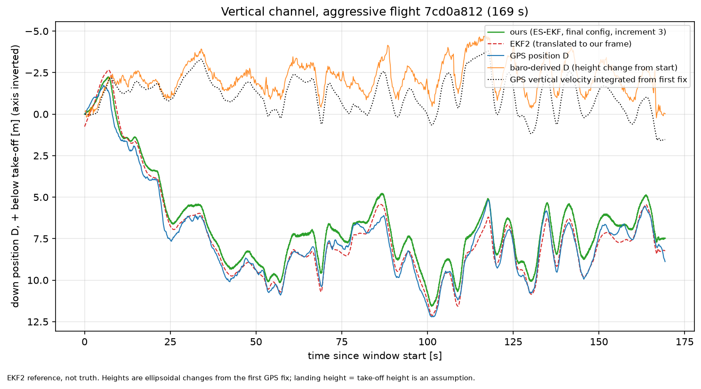
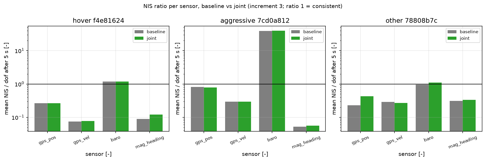

# Project A: 15-state error-state EKF on PX4 logs (Group 4 writeup)

Summary (numbers and sources in sections 3 and 4):

- Horizontal difference to EKF2 (RMS) is about 5 cm (velocity about 0.1 m/s) on two logs and 0.25 m on the RTK log; both filters fuse the same GPS data (3.3).
- For three of four sensors on every log the NIS ratio is far from 1, so the filter is not consistent in the NIS sense (closest to 1: baro on hover and other, 3.4). Tuning changed one parameter: total score 1.816 to 1.770 (-2.6 %).
- The vertical channel on the aggressive log remains dominated by GPS height drift (3.5).

Conventions: `CONVENTIONS.md` (scalar-first Hamilton quaternions, FRD body, NED navigation frame, SI units, angles in degrees only in tables and plots). Assumptions are cited by ID from `assumptions.md` (A-03 ... A-13). **EKF2 is a reference, not truth.** Every comparison below is a *difference to EKF2*, never an error.

Source files for every number are named in the table notes. All paths are relative to `sensor_fusion/report/`.

## 1. Goal and data

Goal: estimate position, velocity and attitude of a multirotor from PX4 logs (IMU, GPS, barometer, magnetometer) with a 15-state error-state EKF built on `common/`, and check it against the EKF2 solution logged by the autopilot. There is no independent ground truth in the logs.

Data: three pinned logs (see `sensor_fusion/data/NOTES.md`), referred to by role.

| Role | Log id (prefix) | Window [s] |
|---|---|---|
| hover | `f4e81624` | 280.02 |
| aggressive | `7cd0a812` | 169.34 |
| other | `78808b7c` | 674.49 |

Window = `duration_s` in `final_metrics_<id>.json`. Statistics skip the first 5 s (initialisation); attitude statistics also skip +/-1 s around the EKF2 quaternion reset (one reset per log, at 16.08 s, 4.21 s and 7.38 s for hover / aggressive / other, `ekf2_reset_times_s`).

## 2. Filter summary

Error-state EKF with state `[dp, dv, dtheta, db_g, db_a]` (15), body-frame right attitude error, Joseph-form updates, strapdown propagation at the IMU rate. Measurements: GPS position, GPS velocity (both delay-corrected, `gps_delay_s` = 0.11 s), baro height change, and tilt-compensated magnetometer heading with IGRF declination. The heading update also corrects tilt (full residual Jacobian, because the measurement uses the estimated tilt). Three increments: 1 = GPS + baro with frozen biases, 2 = + mag heading, 3 = + bias estimation. IMU and GPS noise values start from EKF2's logged parameters (A-03, A-04); baro and heading sigma are tighter than EKF2's (1.5 m against `EKF2_BARO_NOISE` 3.5 m; 0.07 rad against `EKF2_HEAD_NOISE` 0.3 rad). Derivation, Jacobians and the update order are in the module docstring of `sensor_fusion/ekf_drone.py` and in `docs/specs/ekf_drone.md`; they are not repeated here.

## 3. Results

### 3.1 Increment study (Group 3 defaults, `gps_pos_floor_v` = 0.5 m)

Difference to EKF2 (RMS) and NIS ratio (mean NIS after 5 s divided by dof; 1 = expected value for a consistent filter (necessary, not sufficient), see 3.4).

| Log | Inc. | posH [m] | posD [m] | vel [m/s] | tilt [deg] | yaw [deg] |
|---|---|---|---|---|---|---|
| hover | 1 | 0.165 | 0.959 | 0.224 | 1.55 | 6.13 |
| hover | 2 | 0.150 | 0.959 | 0.214 | 1.68 | 4.75 |
| hover | 3 | 0.050 | 1.040 | 0.105 | 1.05 | 5.78 |
| aggressive | 1 | 0.155 | 0.805 | 0.225 | 1.18 | 2.58 |
| aggressive | 2 | 0.156 | 0.805 | 0.224 | 1.10 | 1.29 |
| aggressive | 3 | 0.055 | 0.771 | 0.088 | 0.37 | 1.38 |
| other | 1 | 0.268 | 0.804 | 0.256 | 0.64 | 2.00 |
| other | 2 | 0.304 | 0.804 | 0.297 | 0.84 | 2.88 |
| other | 3 | 0.254 | 0.803 | 0.231 | 0.56 | 1.80 |

| Log | Inc. | gps_pos | gps_vel | baro | mag_heading |
|---|---|---|---|---|---|
| hover | 1 | 0.256 | 0.227 | 1.30 | n/a |
| hover | 2 | 0.252 | 0.209 | 1.30 | 0.479 |
| hover | 3 | 0.266 | 0.075 | 1.18 | 0.089 |
| aggressive | 1 | 0.934 | 0.470 | 38.85 | n/a |
| aggressive | 2 | 0.934 | 0.470 | 38.85 | 0.246 |
| aggressive | 3 | 0.812 | 0.294 | 39.18 | 0.053 |
| other | 1 | 0.270 | 0.330 | 0.938 | n/a |
| other | 2 | 0.299 | 0.416 | 0.938 | 0.228 |
| other | 3 | 0.230 | 0.292 | 0.950 | 0.310 |

Source: `ekf_metrics_<id>.json`, `increments["1".."3"]` (`comparison_vs_ekf2`, `nis.<sensor>.after_5s.mean_nis` / `dof`). Reproduced by `ekf_study.py` with the pre-tuning `G3_DEFAULTS`.

Observations (differences to EKF2 only): estimating biases (inc. 3) lowers the horizontal position and velocity differences relative to inc. 2 on hover (posH 0.150 to 0.050 m, vel 0.214 to 0.105 m/s) and aggressive (posH 0.156 to 0.055 m, vel 0.224 to 0.088 m/s); on other the change is smaller (posH 0.304 to 0.254 m). The posD column is **not an accuracy measure**: EKF2 follows GPS height on two logs and baro on one (CONVENTIONS section 6, A-08), see 3.5. Yaw difference is not monotonic in the increments (hover: 6.13, 4.75, 5.78 deg for inc. 1, 2, 3; other: 2.00 deg without mag, 2.88 deg with mag). Adding mag (inc. 2) raises every difference on the other log (posH 0.268 to 0.304 m, vel 0.256 to 0.297 m/s, tilt 0.64 to 0.84 deg, yaw 2.00 to 2.88 deg). Bias estimation (inc. 3) raises the hover posD difference from 0.959 to 1.040 m.

### 3.2 Final tuned configuration (increment 3, `gps_pos_floor_v` = 0.125 m)

Only one parameter differs from the Group 3 defaults (section 4). Before = `ekf_metrics_<id>.json` inc. 3; after = `final_metrics_<id>.json`.

| Quantity | hover before | hover after | aggr. before | aggr. after | other before | other after |
|---|---|---|---|---|---|---|
| posH RMS [m] | 0.050 | 0.050 | 0.055 | 0.055 | 0.254 | 0.255 |
| posD RMS [m] (not accuracy) | 1.040 | 1.040 | 0.771 | 0.753 | 0.803 | 0.929 |
| vel RMS [m/s] | 0.105 | 0.105 | 0.088 | 0.090 | 0.231 | 0.216 |
| tilt RMS [deg] | 1.05 | 1.05 | 0.365 | 0.366 | 0.559 | 0.561 |
| yaw RMS [deg] | 5.78 | 5.78 | 1.38 | 1.38 | 1.80 | 1.80 |
| gps_pos NIS ratio | 0.266 | 0.266 | 0.812 | 0.790 | 0.230 | 0.420 |
| NIS score (RMS of ln ratio) | 1.892 | 1.892 | 2.433 | 2.435 | 1.123 | 0.981 |

Hover is unchanged because the receiver-reported vertical accuracy (median epv 1.259 m) is above both floors. On the other log the median receiver epv is 0.010 m, so the floor alone sets sigma_v (0.5 m before, 0.125 m after). The adopted change raises the other-log posD difference to EKF2 from 0.803 to 0.929 m; posD is not part of the admissibility guard. The posD differences depend on the baro weighting (`baro_sigma`, section 4), so the posD columns of 3.1 and 3.2 are not a measure of vertical accuracy. Source: `final_metrics_<id>.json`, `consistency.score`; `height_diagnostics.json` (`receiver_median`).

Final NIS ratio (fraction of individual NIS samples inside the two-sided 95 % chi-square interval):

| Log | gps_pos | gps_vel | baro | mag_heading |
|---|---|---|---|---|
| hover | 0.266 (0.915) | 0.075 (0.322) | 1.18 (0.996) | 0.089 (0.907) |
| aggressive | 0.790 (0.957) | 0.296 (0.794) | 39.43 (0.039) | 0.053 (0.896) |
| other | 0.420 (0.729) | 0.267 (0.796) | 1.10 (0.945) | 0.314 (0.943) |

Source: `final_metrics_<id>.json`, `consistency.per_sensor` (ratio, `fraction_inside_95`; after 5 s). No update was rejected (`n_rejected` = 0 for all sensors, all logs).

`fraction_inside_95` is the fraction of individual NIS samples inside the two-sided chi-square(dof) 95 % interval. It is insensitive to over-conservatism for dof 1: the lower bound is 0.00098 for dof 1 and 0.216 for dof 3, so a ratio well below 1 can still leave most samples inside (mag: ratio 0.089 / 0.053 / 0.314 with fraction 0.907 / 0.896 / 0.943). For dof 3 the fraction drops only for the lowest ratios (gps_vel 0.075 / 0.296 / 0.267: 0.322 / 0.794 / 0.796), while hover gps_pos (ratio 0.266) still has 0.915. A fraction near 0.95 together with a ratio well below 1 therefore does **not** indicate consistency. The spec (`docs/specs/tuning_writeup.md` section 7) asked for chi-square bounds per sensor; that is replaced here by the effective-sample-size reading of 3.4.

Figures (EKF2 reference, not truth; EKF2 resets marked): position `figures/final_<id>_pos.png`, attitude `figures/final_<id>_att.png`, bias `figures/final_<id>_bias.png`, NIS `figures/final_<id>_nis.png`, with `<id>` = `f4e81624-7ccc-4859-bb45-d02fa0246b77`, `7cd0a812-d6d6-4c67-9da8-1f3a9cc460b0`, `78808b7c-d9e9-4350-b311-3bb510f29a7b`.

### 3.3 Difference to EKF2 next to EKF2's own uncertainty

| Log | posH diff RMS [m] | EKF2 median eph [m] | vel diff RMS [m/s] | EKF2 median evh [m/s] | receiver median eph [m] | receiver median epv [m] |
|---|---|---|---|---|---|---|
| hover | 0.050 | 0.277 | 0.105 | 0.132 | 0.674 | 1.259 |
| aggressive | 0.055 | 0.178 | 0.090 | 0.107 | 0.293 | 0.559 |
| other | 0.255 | 0.219 | 0.216 | 0.126 | 0.014 | 0.010 |

Source: `final_metrics_<id>.json` (`comparison_vs_ekf2`); `height_diagnostics.json` (`ekf2_reported_median`, `receiver_median`). An RMS difference and a median reported uncertainty are different statistics and are not directly comparable. The difference is about 5 cm horizontal (velocity about 0.1 m/s) on hover and aggressive. Both filters fuse the same GPS data, and the IMU and GPS noise values follow EKF2's logged parameters (A-03, A-04; baro and heading sigma are tighter than EKF2's). A small difference is therefore partly by construction and is not an accuracy statement. On the other log both differences exceed EKF2's own median eph/evh; the projection difference (A-12, <= 0.32 m on this RTK track) exceeds the 0.255 m posH difference and may therefore account for all of it; it is not separated.

### 3.4 How NIS is read here

The chi-square bounds on the **mean** NIS assume n independent samples. For reference, on hover (n = 1356 / 1374 / 549 after 5 s) the independence-based 95 % bounds on the mean NIS are [2.871, 3.132] (gps, dof 3), [0.927, 1.076] (baro) and [0.885, 1.122] (mag). `mean_inside_bounds` in `final_metrics_<id>.json` is computed over all samples (the `after_5s` block has no such flag; every after-5 s mean also lies outside its `mean_bounds_95`) and is false for all four sensors on all three logs.

Time correlation of the innovations widens the bounds on the mean NIS (smaller effective sample size n_eff), but it does not move the expected mean NIS: a correct filter also has white innovations. Ratios near 1 (baro on hover 1.18 and other 1.10) therefore cannot be called inconsistent. Ratios of 0.05 to 0.42 (mag, gps_vel, gps_pos) and 39 (aggressive baro) lie outside the bounds even for a small effective sample size. Smallest n_eff at which the ratio of the final table lies outside the two-sided 95 % interval of the mean of n_eff independent samples (chi-square with n_eff x dof degrees of freedom): aggressive baro 39.43: 1; hover gps_vel 0.075: 2; hover gps_pos 0.266, other gps_vel 0.267, aggressive gps_vel 0.296: 3; other gps_pos 0.420: 6; mag 0.053 / 0.089 / 0.314 (aggressive / hover / other): 3 / 4 / 10; aggressive gps_pos 0.79: about 50; baro 1.18 (hover) and 1.10 (other): 266 and 822. This n_eff check is a reviewer calculation from the ratios with `scipy.stats.chi2`, reproducible by anyone, and is not stored in a JSON. The low ratios indicate mis-specified noise models: S too large for mag and GPS, too small for aggressive-log baro. Correlated innovations are themselves a sign of unmodelled error dynamics. No consistency claim is made; NIS ratios are reported as descriptive numbers.

### 3.5 Vertical channel: landing-height closure (assumption-dependent)

**ASSUMPTION, not verified: landing pad height = take-off height.** Under it the end-of-window down position of a correct estimator would be about 0. Down positive, relative to take-off, ellipsoidal height change; EKF2 translated by its constant vertical origin offset (CONVENTIONS section 6).

| Log | ours [m] | EKF2 [m] | GPS pos [m] | baro [m] | integrated GPS vel [m] | horizontal take-off to landing distance (GPS) [m] |
|---|---|---|---|---|---|---|
| hover | -1.38 | -2.24 | -2.44 | -0.14 | -0.69 | 0.56 |
| aggressive | 7.47 | 8.23 | 8.88 | -0.02 | 1.53 | 7.71 |
| other | -0.25 | 2.15 | -0.24 | 3.08 | -0.38 | 2.27 |

Source: `height_diagnostics.json`, `samples.end_of_window.down_position_m`, `gps_first_to_last_horizontal_distance_m`. For the aggressive log, GPS down position at 40 s and 100 s (`samples.t_40s`, `samples.t_100s`) is 9.16 m and 11.59 m, baro -1.85 m and -1.72 m, integrated GPS velocity -1.22 m and 0.06 m (baro minus GPS: -11.00 m and -13.31 m).

The aggressive log ends in a hard landing/impact at t ~ 167 s (`sensor_fusion/data/NOTES.md` line 36). Its end-of-window values and its landing-closure row (7.71 m horizontal take-off-landing distance) therefore come after the impact, which weakens the landing = take-off assumption for this log. The 40 s and 100 s samples (GPS minus baro: 11.00 and 13.31 m) do not depend on the landing.

Reading: our height lies between the GPS and baro values on hover, nearer GPS on aggressive, and within 0.02 m of GPS on other. On the aggressive log GPS position departs from both baro and the integrated GPS velocity, which agree to within 0.6 / 1.8 / 1.6 m (at 40 s / 100 s / end of window), versus 9-13 m for GPS position against baro (figure below); GPS position minus integrated GPS velocity at the end is 7.35 m. No sensor closes best on all three logs (baro on hover and aggressive, GPS on other). Which sensor is right cannot be decided from the logs. EKF2's end value is nearest GPS on hover and aggressive and nearest baro on other, which fits the stated EKF2 height reference per log (A-08). CONVENTIONS section 6 maps the height reference to firmware version (GPS on v1.17, baro on v1.14); the log-to-version mapping (hover and aggressive v1.17, other v1.14) is in `sensor_fusion/data/NOTES.md` lines 35-37. Neither mapping is a number in the JSON.



Same figure for the other logs: `figures/height_diagnostics_f4e81624-7ccc-4859-bb45-d02fa0246b77.png` and `figures/height_diagnostics_78808b7c-d9e9-4350-b311-3bb510f29a7b.png` (EKF2 reference, not truth).

### 3.6 Dead-reckoning context

Free strapdown integration of the raw IMU (no bias removal, seeded from EKF2; `dr_metrics_<id>.json`, `position_error_m`) differs from EKF2 in position by 10.76 / 9.05 / 2.41 m after 10 s and 694.98 / 320.34 / 255.63 m after 60 s (hover / aggressive / other). Context only: the aiding measurements are what keep the EKF solution within the differences of 3.2.

## 4. Tuning study

**Procedure.** Sweep on increment 3, all three logs, deterministic (`tuning_sweep.py`, `tuning_sweep.json`, `tuning_sweep.md`). Nine knobs (`accel_noise`, `gyro_noise`, `gyro_bias_rw`, `accel_bias_rw`, `gps_pos_floor_h`, `gps_pos_floor_v`, `gps_vel_floor`, `baro_sigma`, `mag_heading_sigma`), factors 1/4, 1/2, 2, 4 one at a time (stage 1, baseline plus 36 configurations), then three joint candidates (stage 2): `joint` (each knob at its best admissible stage-1 factor), `joint_halfstep` (each one step toward 1), `joint_no_mag`. 40 configurations x 3 logs = 120 runs, wall time 500.3 s on 20 workers. **Scoring rule and admissibility guard were fixed before the sweep** (`docs/specs/tuning_writeup.md` section 5): score per log = RMS over sensors of ln(NIS ratio) after 5 s, total = mean over logs; a configuration is admissible only if on every log posH, velocity and tilt differences to EKF2 are each at most 1.15 times the baseline value; the lowest admissible total wins.

Best admissible factor per knob (`tuning_sweep.md`, per-knob table; baseline total 1.816):

| Knob | Selected factor | Total score | Note |
|---|---|---|---|
| accel_noise | x1 | 1.816 | all four other factors inadmissible |
| gyro_noise | x1 | 1.816 | only x2 admissible (1.893) |
| gyro_bias_rw | x0.25 | 1.765 | edge of range |
| accel_bias_rw | x0.25 | 1.814 | edge of range; change of 0.002 |
| gps_pos_floor_h | x1 | 1.816 | all other factors inadmissible |
| gps_pos_floor_v | x0.25 | 1.770 | edge of range |
| gps_vel_floor | x1 | 1.816 | all other factors inadmissible |
| baro_sigma | x1 | 1.816 | x2 and x4 admissible (1.965, 2.235) |
| mag_heading_sigma | x1 | 1.816 | x2 and x4 admissible (2.133, 2.497) |

The guard is strict. `accel_noise` x2 is flagged inadmissible, e.g. by the aggressive-log velocity difference (0.114 vs 0.088 m/s) and by the hover tilt difference (1.42 vs 1.05 deg). Lower scores that the guard rejected: `gps_vel_floor` x0.25 (1.529; aggressive posH 0.146 vs 0.055 m), `mag_heading_sigma` x0.25 (1.453; hover tilt 3.20 vs 1.05 deg), `accel_noise` x0.25 (1.632; hover tilt 3.30 vs 1.05 deg).

Candidates (`tuning_sweep.md`; per-log NIS score):

| Config | Admissible | Total | hover | aggressive | other |
|---|---|---|---|---|---|
| baseline (G3) | yes | 1.816 | 1.892 | 2.433 | 1.123 |
| gyro_bias_rw x0.25 | yes | 1.765 | 1.786 | 2.411 | 1.097 |
| accel_bias_rw x0.25 | yes | 1.814 | 1.892 | 2.433 | 1.118 |
| **final: gps_pos_floor_v x0.25** | yes | 1.770 | 1.892 | 2.435 | 0.981 |
| joint (sweep winner) | yes | 1.717 | 1.786 | 2.413 | 0.952 |
| joint_halfstep | yes | 1.758 | 1.832 | 2.421 | 1.022 |
| joint_no_mag | yes | 1.717 | 1.786 | 2.413 | 0.952 |

`joint_no_mag` is identical to `joint` because the selected mag factor stayed at 1, so the two configurations are the same.

**Decision.** Only `gps_pos_floor_v` 0.5 to 0.125 m was adopted (A-13). The sweep winner `joint` was not adopted in full:

- The score gain of lower `gyro_bias_rw` comes from the magnetometer NIS. On hover, where the vertical floor is inactive, `joint` differs from the baseline in per-sensor ratio essentially only for mag (0.089 to 0.122; gps_vel 0.075 to 0.077; gps_pos and baro unchanged), and the same direction holds on the other logs (aggressive 0.053 to 0.057, other 0.310 to 0.335). The interpretation recorded in A-13 is that a too-small Q offsets a too-large R, which is not a better filter. Lower `gyro_bias_rw` also moves hover yaw difference from 5.78 to 6.04 deg for `joint`; `gyro_bias_rw` x0.25 alone gives 6.03 deg.
- `accel_bias_rw` x0.25 changes the total score by 0.002 (1.816 to 1.814); there is no basis for changing it (A-13).
- The vertical floor is supported by the receiver data: median epv is 0.010 m on the other log, while the floor was 0.5 m.
- Score gain with mag (all logs) and the aggressive-log baro excluded from the score (RMS of ln ratio over the remaining sensors per log, mean over logs; recomputed from the per-sensor ratios in `tuning_sweep.json`, `results.<config>.<log>.per_sensor.<sensor>.ratio`, baseline 1.223): `gyro_bias_rw` x0.25 0.010, `gps_pos_floor_v` x0.25 0.065, `accel_bias_rw` x0.25 0.0025. This is a post-hoc recomputation that is not stored in a JSON. For `gyro_bias_rw` x0.25 the gain is about five times smaller than in the full score (1.816 to 1.765).

**Post hoc.** The choice deviates from the rule's winner and was made after seeing the results. The baseline was already close to the best admissible configuration: total score 1.816 to 1.770 for the adopted change versus 1.717 for `joint`. The three logs used for tuning are also the logs used for evaluation; there is no held-out log.

**What moved and what did not.** Score changes come from the gps_pos ratio on the other log (0.230 to 0.420) and, in `joint`, from mag. Aggressive-log baro NIS ratio is 38.89 to 39.43 in every sweep configuration except all `baro_sigma` factors and `gps_pos_floor_v` x2 / x4 (`gps_pos_floor_v` x0.25 and x0.5 also change the vertical weighting and stay at 39.43): `baro_sigma` x0.25 / x0.5 / x2 / x4 give 146.04 / 105.40 / 10.98 / 2.83, `gps_pos_floor_v` x2 / x4 give 28.88 / 11.17 (`tuning_sweep.json`, `results.<config>.<log>.per_sensor.baro.ratio`). Inflating `baro_sigma` only trades score between logs (x2: hover 2.409, aggressive 2.101, other 1.385; x4: 3.063, 1.832, 1.812 against 1.892, 2.433, 1.123 at baseline), so it was not inflated. `gps_pos_floor_v` x2 and x4 are inadmissible.

Tested sensitivities (differences to EKF2 only, not accuracy statements):

- `baro_sigma` x2 / x4 (3.0 / 6.0 m) cut the posD difference on hover (1.040 to 0.363 / 0.145 m) and aggressive (0.771 to 0.229 / 0.126 m), the two logs where EKF2 follows GPS height; on other, where EKF2 follows baro, it rises (0.803 to 0.905 / 0.940 m). x2 (3.0 m) is near EKF2's `EKF2_BARO_NOISE` 3.5 m (A-04). This is why the posD columns of 3.1 and 3.2 depend on the baro weighting.
- `mag_heading_sigma` x2 / x4 lower the tilt difference on all logs (hover 1.05 to 0.95 / 0.93 deg, aggressive 0.37 to 0.31 / 0.27 deg, other 0.56 to 0.41 / 0.42 deg); x4 (0.28 rad) is close to EKF2's `EKF2_HEAD_NOISE` 0.3 rad (A-04). Both knobs worsen the NIS score (x2: 2.133 for mag, 1.965 for baro, against 1.816).
- The adopted `gps_pos_floor_v` change raises the other-log posD difference from 0.803 to 0.929 m (3.2).

**Limitation of the score.** It treats a ratio of 0.05 and a ratio of 20 alike (ln 0.05 and ln 20 have the same magnitude) and weights all four sensors equally, so a very low mag ratio and a very high baro ratio can contribute equally.



Per-knob sweeps: `figures/tuning_sweep_<knob>.png` for the nine knobs listed above (consistency score and posH difference to EKF2 (reference, not truth) against factor).

## 5. Failure modes and limits

Only items with evidence; "consistent with" marks a reading that was not tested.

**(a) Accel bias: hover horizontal unobservability; aggressive-log disagreement with EKF2.** Final accel-bias sigma on hover is 0.128 / 0.134 / 0.010 m/s^2 (x / y / z) against a prior of 0.2 m/s^2 (`sigma_ba0`), while the aggressive and other logs reach 0.0098 / 0.0098 / 0.0035 and 0.0057 / 0.0063 / 0.0033 m/s^2.

| Axis | ours +/- sigma [m/s^2] | EKF2 end value (reference) [m/s^2] |
|---|---|---|
| x | 0.040 +/- 0.128 | -0.139 |
| y | -0.311 +/- 0.134 | -0.193 |
| z | -0.028 +/- 0.010 | -0.002 |

Source: `final_metrics_f4e81624-....json`, `final_biases`, `ekf2_bias_reference.accel_bias_end`. Consistent with a level hover that gives no motion to separate horizontal accel bias from tilt; not tested. Hover differences to EKF2's end value are at most 2.6 sigma.

Aggressive log, same source (`final_metrics_7cd0a812-....json`):

| Axis | ours +/- sigma [m/s^2] | EKF2 end value (reference) [m/s^2] | difference [sigma] |
|---|---|---|---|
| x | 0.065 +/- 0.0098 | -0.001 | 6.8 |
| y | -0.118 +/- 0.0098 | +0.118 | 24.1 |
| z | -0.012 +/- 0.0035 | -0.035 | 6.7 |

The y axis has the opposite sign. This is not a sign-convention problem: the final gyro biases agree with EKF2's end values within 0.84 sigma on all three logs (0.26 / 0.30 / 0.84 sigma largest axis, hover / aggressive / other). On the other log the accel-bias differences are up to 3.6 sigma (z). The cause is not tested. The aggressive log ends in a hard impact at t ~ 167 s (3.5), so its end-of-window biases, ours and EKF2's, are also taken after the impact.

**(b) Hover yaw difference to EKF2.** 5.78 deg RMS (signed mean -5.26 deg, maximum 8.07 deg), against 1.38 deg and 1.80 deg on the other two logs. The magnetometer hard-iron bias is not corrected in our filter while EKF2 estimates a mag bias (A-11, A-08). Consistent with, not tested: no run with a hard-iron correction exists. Sensitivity tested in the sweep (differences to EKF2 only): `mag_heading_sigma` x2 lowers the yaw difference on aggressive (1.38 to 0.99 deg) and other (1.80 to 0.93 deg) and leaves hover at 5.95 deg; x4 gives 5.87 / 0.73 / 0.81 deg (hover / aggressive / other). The same knob lowers the tilt difference on all logs (section 4). These are tested sensitivities, not evidence of better yaw or tilt: the reference is EKF2, and the NIS score worsens (2.133 at x2).

**(c) Aggressive-log baro NIS ratio about 39.** Not removed by any process-noise, mag, horizontal-GPS or velocity knob (section 4). Consistent with the GPS vertical position drifting against its own integrated velocity and against baro (section 3.5). The filter height follows GPS. A baro-offset state would be expected to make the baro NIS consistent (untested) but would not fix the height; both statements are untested reasoning. `sigma_baro` was not inflated.

**(d) GPS delay.** The sweep did not vary `gps_delay_s` (0.11 s); sensitivity was not re-tested in Group 4. The Group 3 synthetic test showed a benefit of the delay correction; no number is quoted here.

**(e) Mag heading nonlinearity at high inclination.** The tilt-compensated heading residual is strongly curved at high inclination (module docstring, A-11, Group 3 notes); not quantified in Group 4.

**(f) EKF2 yaw-reset exclusion.** Attitude statistics exclude +/-1 s around each EKF2 reset (40 samples on hover, `n_att_samples_excluded_resets`). The aggressive-log reset (4.21 s) lies inside the 5 s initialisation skip. Differences near a reset are not evaluated.

**(g) Low NIS ratios.** mag (0.089 / 0.053 / 0.314), gps_vel (0.075 / 0.296 / 0.267) and hover gps_pos (0.266) are far below 1 (hover / aggressive / other, final). Documented limitation. Time correlation widens the bounds on the mean but does not lower the expected mean (3.4), so these ratios indicate S too large. A slowly varying mag bias is a plausible explanation for mag, not tested; no explanation is tested for GPS. Tightening was not adopted because it raises the tilt difference to EKF2 (`mag_heading_sigma` x0.25: hover tilt 3.20 deg) or fails the guard.

## 6. Reproduction

From the repository root (Windows):

```bash
.venv/Scripts/python -m sensor_fusion.download_logs               # pinned logs
.venv/Scripts/python -m sensor_fusion.run_flight all              # final_metrics_<id>.json, figures/final_*
.venv/Scripts/python -m sensor_fusion.report.tuning_sweep         # tuning_sweep.json/.md, figures/tuning_sweep_* (~8 min, 20 workers; overwrites the committed files)
.venv/Scripts/python -m sensor_fusion.report.tuning_sweep --replot  # figures and markdown from the committed tuning_sweep.json, no runs
.venv/Scripts/python -m sensor_fusion.report.height_diagnostics   # height_diagnostics.json, figures/height_diagnostics_*
.venv/Scripts/python -m sensor_fusion.report.ekf_study            # ekf_metrics_<id>.json, figures/ekf_*
.venv/Scripts/python -m sensor_fusion.report.dr_study             # dr_metrics_<id>.json (section 3.6)
.venv/Scripts/python -m pytest -q                                 # all tests
```

`ekf_study` uses `G3_DEFAULTS`, the pre-tuning values, so the increment table of 3.1 stays reproducible. The sweep baseline is also pinned to `G3_DEFAULTS`, so the sweep command reproduces the tables of section 4; `run_flight` uses the `EkfConfig` defaults at the time of the run. Dead-reckoning numbers (3.6) come from `sensor_fusion/report/dr_study.py`. Runtime of the sweep: 500.3 s; of `height_diagnostics`: 134.5 s (`total_runtime_s`).

## 7. Not done / limitations

- No independent ground truth; all comparisons are differences to EKF2 (reference, not truth).
- Three logs only, one per role; the tuned configuration is evaluated on the logs it was tuned on.
- The tuned choice is post hoc relative to the scoring rule (section 4).
- Sweep run on increment 3 only; increments 1 and 2 not re-tuned.
- `gps_delay_s`, hard-iron correction, a baro-offset state and the time correlation of GPS errors were not tested in Group 4.
- NIS consistency is not claimed: for three of four sensors on every log the ratio is outside the bounds even for a small effective sample size (section 3.4).
- Vertical accuracy is not claimed; the landing-height closure rests on an unverified assumption.
- Local frame is a flat, non-rotating NED (A-01, A-12).
